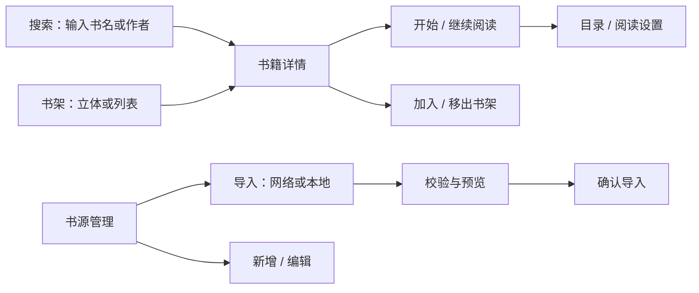

# Noval 页面设计 · V1

设计目标是舒适、容易上手、操作便捷。采用暖纸色背景、墨绿主色和少量陶土色，保留书卷感，同时让搜索、阅读与书源操作清晰可见。

设计资料保留在 `docs/desgin/`，页面样式已按这些画板落地到 Expo 应用。业务逻辑、路由与存储行为保持原有流程；目录沿用需求中的 `desgin` 拼写。

## 打开设计稿

- [交互设计稿](index.html)：直接用浏览器打开，无需启动 Expo、安装依赖或联网。左侧切换页面，右侧切换状态，中间操作手机原型。
- [8 页视觉总览](overview.html)：同时查看主要页面。
- [颜色、字体与尺寸变量](tokens.json)：供应用页面样式对照使用。
- [预览图片](previews/)：总览、完整工作台、主要页面和关键弹层的 PNG。

若使用本地 HTTP 预览，可在项目根目录运行 `python3 -m http.server 8767 --directory docs/desgin`，访问 `http://localhost:8767/`。

参考画板为 390 × 844，数值表示逻辑尺寸。浏览器模拟状态栏与底部手势条仅用于展示；正式实现应读取平台安全区域。

## 设计范围与现有页面对应

| 页面 | 现有代码 | 设计重点 |
| --- | --- | --- |
| 书架 | `src/app/(tabs)/index.tsx` | 立体 / 列表切换、查看书籍、移除、搜索入口与空书架 |
| 搜索 | `src/app/(tabs)/discover.tsx` | 搜索框、已启用书源选择、结果、逐源状态与重新搜索 |
| 书籍详情 | `src/app/book/[sourceId]/[bookId].tsx` | 封面、简介、收藏、开始 / 继续阅读、章节目录与刷新 |
| 阅读器 | `src/reader/ReaderScreen.tsx`、`ReaderControls.tsx` | 正文、翻页、菜单、章节切换、目录与现有阅读设置 |
| 书源管理 | `src/app/(tabs)/sources.tsx` | 名称搜索、启停筛选、单项操作、全部操作与批量删除 |
| 导入书源 | `src/app/source/import.tsx` | 网络、本地文件、粘贴 JSON、预览、重复处理与完成反馈 |
| 新增 / 编辑 | `src/components/SourceEditor.tsx` | 现有信息字段、启用开关、原始 JSON、示例、保存与取消 |
| 我的阅读 | `src/app/(tabs)/profile.tsx` | 现有藏书数、已启用源数与本机进度说明 |

四个底部入口保留为 **搜索、书架、书源、我的**，与现有顺序一致。详情、阅读、导入与编辑沿用现有独立页面层级。

## 核心流程

### 书架

顶部只保留页面标题与搜索入口。立体浏览与列表切换使用分段图标按钮，当前选中状态有明确底色和可访问标签。

立体视图突出一本书，两侧露出相邻封面，支持现有滑动 / 切换行为。书名、作者、分类与连载状态形成稳定信息区。「查看书籍」进入详情，继续阅读仍由详情处理。移出书架维持现有动作，以低强调文字显示；本次设计不增加书架排序、分组或新的阅读快捷逻辑。

列表每行保留封面、书名、作者、分类、状态和移除入口。大量书籍时正式实现应采用虚拟列表，不一次创建全部封面。

### 搜索

输入框优先，支持原有约 350ms 输入延迟搜索和键盘提交。保留原有空输入时的离线示例；没有示例可显示时展示输入引导，避免制造「热门推荐」等新数据。

选择书源使用底部弹层，可查找已启用的书源，默认显示全部书源。书籍结果保持所属书源，不把跨源同名书合并成新的数据结构。

顶部先显示结果数与已完成进度，详细的匹配、未匹配、失败和规则未支持统计移入可展开的「各书源搜索情况」，原有信息全部保留。部分源失败时仍展示成功结果；失败源与空结果源用文字区分。

### 详情与目录

顶部封面与书名并列，下面依次为简介、阅读与收藏、上次阅读位置、目录。阅读按钮在有可读章节时出现；已有有效进度显示「继续阅读」，否则显示「开始阅读」。没有可读目录时不可制造可用的阅读按钮。

目录独立显示加载 / 错误，不因目录失败隐藏已经加载的书籍信息。刷新保持在目录标题右侧。章节当前状态增加「在读」文字，锁定章节显示「未解锁」且不可点击。实际章名、章数、状态和错误必须来自现有数据。

### 阅读器

正文区域使用暖纸色 `#F4EFDF` 与深棕文字 `#403E35`。默认字号 18、行距 1.9，段落首行缩进；章节名与页码保持弱强调。装饰仅用于书架封面，不进入阅读正文。

左右点击区、中心唤出菜单区与原有滑动翻页保持一致，不能让提示浮层截获手势。图中的「轻点中间…」为操作提示设计示意，正式实现可复用无持久化状态的说明文案；不要求增加引导状态或弹窗流程。

菜单保留返回、加入书架、上一章、下一章、目录和设置。已在书架时禁用重复添加；首章 / 末章、锁定章与切换中保持原有禁用条件。

设置仅包含当前已有选项：字号 14–30、步长 2；行距紧凑 / 适中 / 宽松（1.5 / 1.9 / 2.3）；动画滑动 / 淡入淡出 / 无动画。修改即时生效，继续使用当前保存方式。没有新增夜间主题、亮度、字体下载、听书或缓存功能。

### 书源管理

启用数量及「启用的书源会参与搜索」位于顶部；导入与新增前置。名称 / 网址 / 分组搜索以及全部 / 已启用 / 已停用筛选保留。

卡片展示名称、网址、文本 / 音频等现有类型、分组、发现规则标识和启用状态；示意卡片为精简示例，正式实现不能丢弃现有元信息。启用开关不等于站点健康检测，不使用「正常」「极速」「已验证」等未经检测的状态。

编辑、单项导出与删除仍在卡片底部。更多菜单承接全部导出、全部启用、全部禁用和批量删除。批量模式保留当前可见全选 / 取消选中、已选数量、取消、删除所选；确认前展示受影响的书源与收藏数量。

删除确认保留现有业务含义，实际受影响的收藏数由应用计算，只有大于 0 才显示。弹窗默认聚焦取消按钮。原型中的「2 本收藏」只是视觉示例。

### 导入与编辑

网络与本地 JSON 用分段选项切换；本地页同时保留系统文件选择和粘贴输入。下载中的取消、正在处理的禁用状态继续保留。XIU2 地址快捷填入保留，输入字段说明不再挤占整屏。

预览保留现有前 30 项及剩余数量提示。重复项默认跳过，开启覆盖时说明会替换规则与启用状态。完成显示实际新增、更新、跳过数量，并保留返回书源列表入口。

编辑页分为基本信息、启用状态、规则 JSON。基本信息四个字段不变；规则仍为原始 JSON 对象。英文底层字段名可放到辅助说明，便于首次用户理解中文标签。新增模式保留「填入示例」，编辑模式不出现此入口。

原型按钮只演示视觉流程，不下载网络数据、不打开系统文件、不实际导出或持久化；表单和状态仅在原型内存中存在。正文为排版示意，封面为 CSS 绘制示意，不是原书封面或真实章节。搜索结果不随关键词执行真实查询，模拟结果标明用于布局预览。

### 我的阅读

只展示现有的书架藏书与已启用书源统计，以及进度保存在本机的说明。不增加账户、连续阅读天数、阅读时长、云同步等当前没有的功能。

## 视觉与布局规范

| 用途 | 值 | 使用约束 |
| --- | --- | --- |
| 页面底色 | `#F6F3EC` | 暖纸白，大面积连续使用 |
| 卡片 / 输入表面 | `#FFFEFA` | 靠底色和细边界区分层级 |
| 正文 / 标题 | `#252D28` | 正文不使用纯黑 |
| 辅助文字 | `#677169` | 文案仍需清晰可读 |
| 主操作 / 选中 | `#294E42` | 实心主按钮、选中入口 |
| 浅绿色 | `#E8EEE5` | 当前章节、标签、选中底色 |
| 陶土色 | `#BA694B` | 少量装饰；不作小号正文颜色 |
| 边界 | `#E3E5DC` | 装饰性分隔；交互选中状态不只依赖此颜色 |
| 危险操作 | `#A34436` | 删除文案及确认按钮 |

字号：页面标题 27，区块标题 17，常规正文 / 主按钮 14，辅助正文 12，Tab 标签 10。画板中的字标、封面英文和状态栏是装饰示意，不作为信息正文。系统字体用于功能界面；衬线仅用于少量情绪标题、示意封面及正文预览。正式应用的阅读字体继续使用现有字体方案，不新增字体依赖。

间距按 4 / 8 / 12 / 16 / 20 / 24 / 32 / 40 组织。画板左右内边距约 24，区块间距 24–32，卡片内边距 16–20。主按钮高 50，输入框高 50，所有可点击目标至少 44 × 44。按钮圆角 13，卡片约 18，底部弹层 24。

底部导航保留悬浮轻玻璃观感，常规卡片不大量使用模糊与阴影。选中入口用浅绿实底和字重表达，平台玻璃效果不可用时应使用现有降级方案。内容底部预留导航高度、间距与安全区，禁止遮住主要按钮或列表末项。

## 响应式与无障碍

- 以 390 宽为参考，兼容 320–430 的手机；正式页面不硬编码整屏高度。窄屏允许标题、标签、表单动作换行，输入区不挤压开关。
- 平板及 Web 正式应用内容宽度上限沿用约 760，正文建议控制在 640 内；设计工作台外框只用于评审。
- 正式实现必须使用现有安全区与键盘避让，底部弹层随内容滚动，横屏时不超出可用高度。
- 字体放大时卡片增高、章名换行，关键文案不可只靠截断；输入标签始终可见。
- 普通功能文字对比度目标至少 4.5:1；色彩之外同时提供选中底色、文字标识与可访问状态。
- 图标按钮提供中文名称，开关声明当前状态，目录标明在读与未解锁。正文与操作区的屏幕阅读顺序一致。
- 弹层拥有标题、关闭入口、模态语义；键盘焦点限制在弹层内，关闭后回到触发入口。原型支持 Tab 与 Esc；正式实现采用现有原生 Modal 行为。
- 尊重减少动态效果设置；普通按压约 120ms，选择约 180ms，弹层约 220ms。阅读翻页动画继续使用现有选项。

## 状态覆盖

| 页面 | 原型可切换状态 | 正式实现需保留的其他状态 |
| --- | --- | --- |
| 书架 | 立体、列表、空书架、加载失败 | 首次加载、移除失败、存储重试 |
| 搜索 | 结果、未输入、搜索中、无结果、全部失败 | 部分失败、规则未支持、未启用书源、选择器无匹配 |
| 详情 | 已有进度、首次阅读、目录失败、加载中 | 书籍失败、无目录、存储 / 进度读取错误 |
| 阅读 | 正文、菜单、设置、目录、加载失败 | 翻页中、首末章、锁定章、进度 / 偏好保存错误 |
| 书源 | 列表、批量选择、空列表、删除确认 | 搜索空列表、操作中、导出反馈、删除失败 |
| 导入 | 网络、本地、重复预览、成功、下载失败 | 下载中与取消、非法 JSON、30 项以上预览、存储错误 |
| 编辑 | 编辑、新增、校验失败 | 保存中、保存失败、保留输入 |
| 我的 | 现有数据展示 | 数量为零时正常展示 |

设计原型优先验证主要视觉状态；并非所有业务分支都在 HTML 中运行。后续落地不得删除上表中的现有处理。

## 应用落地边界

应用已统一浅色视觉变量、公共按钮 / 输入 / 书籍卡片，并调整各页面布局、阅读工具及弹层。路由参数、搜索适配器、数据库、进度算法和书源规则沿用原有行为；将书源全部操作移至更多菜单只是入口布局调整。原有的系统跟随与手动深浅色切换、Logo 继续保留。

## 本次验证

- 浏览器检查了 31 个页面状态，无脚本运行错误。
- 验证了书架 → 详情 → 阅读、字号调整、书源选择、导入预览与重复覆盖、收藏切换、批量全选 / 取消及删除弹窗关闭。
- 工作台在 320、375、390、430、768、1440 宽度下没有横向溢出。
- 主要文字组合的对比度检查后，调深了阅读器辅助文字。
- 项目的 `npx expo lint` 与 `npx tsc --noEmit` 均通过。
- 已导出 16 张预览。需要更新图片时，从项目根目录执行 `node docs/desgin/render-previews.cjs`；使用项目现有 Playwright 和已安装的 Chromium 或 Chrome。
